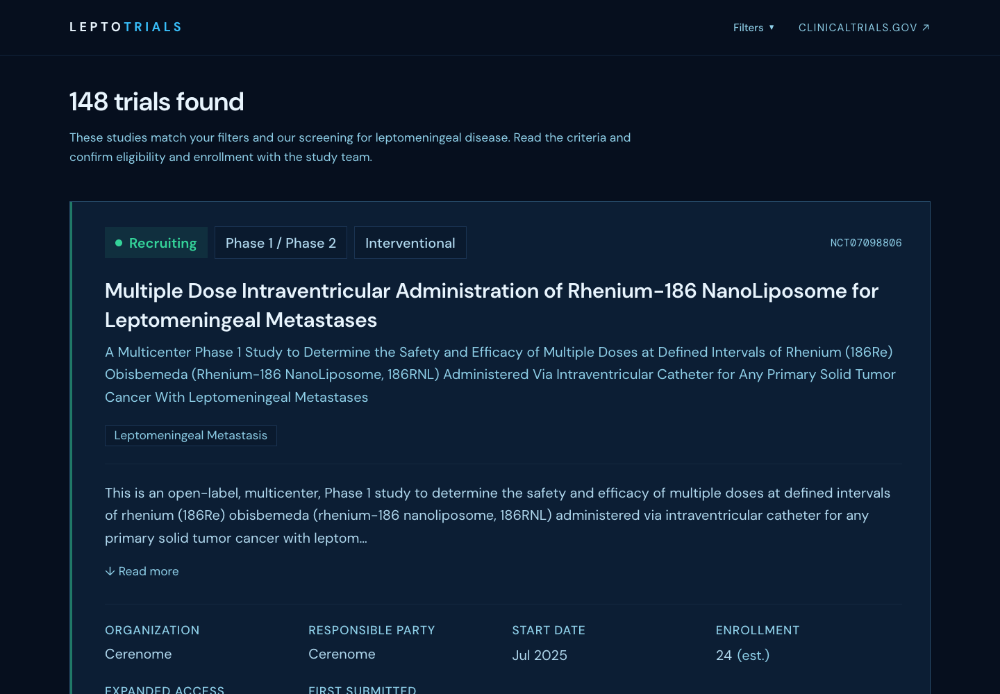
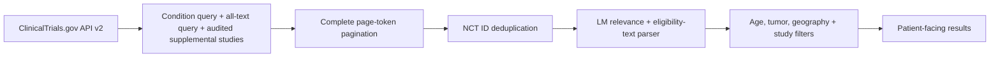
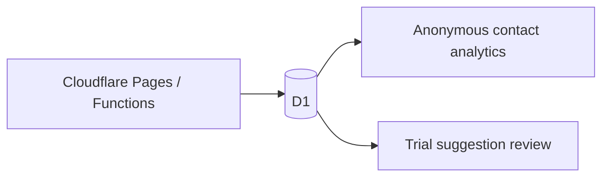

# LeptoTrials

[](https://github.com/tejgluth/LeptoTrials/actions/workflows/ci.yml)
**[Try LeptoTrials](https://leptotrials.com)**

Clinical trial search for people with leptomeningeal metastasis (LM). LeptoTrials combines complementary registry searches, screens eligibility text, and adds audited studies that a keyword search can miss. Patients can compare criteria, locations, and contacts without creating an account.



## Problem

A registry search can return a study because it **excludes** LM, while missing a broader cancer study that accepts LM in one cohort. Patients and caregivers then have to read long protocols to find relevant options. LeptoTrials brings that screening and the next steps into one focused interface.

## Why LeptoTrials is different

- **Search coverage:** condition and all-text queries run in parallel alongside audited supplemental studies. Both complementary searches are paginated completely, then records are deduplicated by NCT ID.
- **Eligibility-aware screening:** inclusion and exclusion sections, negative inclusion phrases, age units, and tumor evidence inform the results. Audited overrides handle mixed cohorts and ambiguous wording.
- **Reliable requests:** cancellation and stale-search guards prevent older results from replacing newer ones. HTTP 429 and 5xx responses use exponential backoff; failed or looping pagination produces an error instead of a partial list.
- **A useful next step:** study contacts, editable inquiry emails, original registry links, and a trial-suggestion form help users follow up. Suggestions enter a private review queue rather than changing results automatically.

Results are possible options to discuss with a care team. They do not establish patient eligibility or available enrollment. Default statuses include **active, not recruiting** studies.

## Architecture





The React app queries the public registry directly. Pages Functions validate contact events and trial suggestions and store them in D1. Analytics and suggestion review require a bearer token. Writes use bound SQL parameters, origin checks, and payload validation; suggestion submissions also have a per-client rate limit and verify an NCT ID against the registry.

## Search pipeline

1. Validate study type, phase, and country parameters; build `query.cond` and `query.term` requests with the chosen registry filters.
2. Fetch both searches and the supplemental ID query concurrently. Follow page tokens to completion, with a 20-page safety limit on each complementary search. Repeated tokens or overflow fail the search.
3. Merge records once per NCT ID. Apply the same status, phase, study-type, and country checks to supplemental records, then continent filtering.
4. Parse eligibility sections and LM context in conditions, titles, summaries, and inclusion text. Reject negative inclusion phrases and explicit exclusions where applicable. Audited classifications resolve known exceptions; age bounds still apply.
5. Apply tumor labels from audited records or infer them from condition, title, summary, keyword, and MeSH evidence. Render study details and contacts.

The implementation is in [`useTrialSearch`](src/hooks/useTrialSearch.ts), [`apiClient`](src/utils/apiClient.ts), and [`trialFilter`](src/utils/trialFilter.ts). Age filtering actually runs inside LM screening; the diagram groups the patient filters for readability.

## Validation

[`validate-trials.ts`](scripts/validate-trials.ts) compares app projections with a separately implemented oracle across an age, tumor, geography, status, phase, and study-type matrix. It also checks known NCT regressions and compares representative filtered queries with the live registry. This checks search consistency, not clinical eligibility or a measured accuracy score.

Audited classifications are versioned in [`manualAuditOverrides.ts`](src/utils/manualAuditOverrides.ts); supporting review exports live in [`audit/manual-review`](audit/manual-review). Registry data changes, so a historical fixture and a live validation run serve different purposes.

Validated on **October 6, 2026**: 403 registry studies, 11,664 local filter combinations, and 16 live query comparisons. No oracle mismatches, known-trial regression failures, or live-query differences were found.

```bash
npm run validate:trials -- --json
# Optional: query the live registry for every matrix scenario (many requests).
npm run validate:trials -- --live-all --json
```

## Technical stack

| Layer | Tools |
| --- | --- |
| Interface | React 19, TypeScript, Tailwind CSS 4, GSAP; reduced-motion support |
| Search | ClinicalTrials.gov API v2, Fetch, AbortController, deterministic text parsing |
| Backend | Cloudflare Pages Functions, D1, Wrangler migrations |
| Build and checks | Vite 8, ESLint, TypeScript, Node test runner with `tsx`, GitHub Actions |

## Testing

```bash
npm run test    # Offline regression tests
npm run check   # Tests, lint, and production build
```

[`tests/trialFilter.test.ts`](tests/trialFilter.test.ts) directly exercises section parsing, negative inclusion wording, exclusion-only mentions, age boundaries, tumor inference, and audited exceptions. Frozen registry fixtures cover cases such as **NCT03093116** (asymptomatic LM allowed, symptomatic LM excluded), **NCT03202940** (LM radiation washout), and **NCT02896335** (different rules for two cohorts). Their source URLs and retrieval dates are included. Synthetic cases use an unaudited ID so overrides cannot hide parser failures.

The suite contains **60 passing tests**. Other suites cover pagination failures, cancellation, registry errors, age units, outreach email encoding, suggestion validation, analytics access, and backend request handling. GitHub Actions runs `npm ci` and `npm run check` on pushes and pull requests; live registry validation is separate so CI does not depend on upstream availability.

## AI usage

AI coding tools assisted development, debugging, documentation, and regression-test work. Trial matching at runtime uses explicit TypeScript rules and versioned audited overrides; it does not call an LLM or generate medical advice. Classification changes need review against the original study record. Automated checks support that review but do not replace it.

## Running locally

Use Node.js **22.12 or newer**.

```bash
npm ci
npm run dev
```

Open the local URL printed by Vite. Search uses the public registry and needs no API key. To run analytics and trial suggestions locally with Pages Functions and D1:

```bash
npm run d1:migrate:local
cp .dev.vars.example .dev.vars
# Replace the placeholder ANALYTICS_ADMIN_TOKEN with a private local value.
npm run dev:cloudflare
```

Open `/analytics` and enter that local token to view contact analytics and the suggestion review queue. `/suggest-trial` is the public submission form. D1 records email-click and email-copy intent, not email contents, recipient addresses, or patient search filters. The suggestion rate limiter stores a secret-salted IP digest rather than the raw address.

Deployment uses the bindings in [`wrangler.jsonc`](wrangler.jsonc). Configure `ANALYTICS_ADMIN_TOKEN` as a Cloudflare secret, apply `npm run d1:migrate:remote`, and run `npm run deploy` with access to the configured Pages project and D1 database. See [`CONTRIBUTING.md`](CONTRIBUTING.md) for change and review conventions.

Trial data comes from [ClinicalTrials.gov](https://clinicaltrials.gov). LeptoTrials is an independent application.
