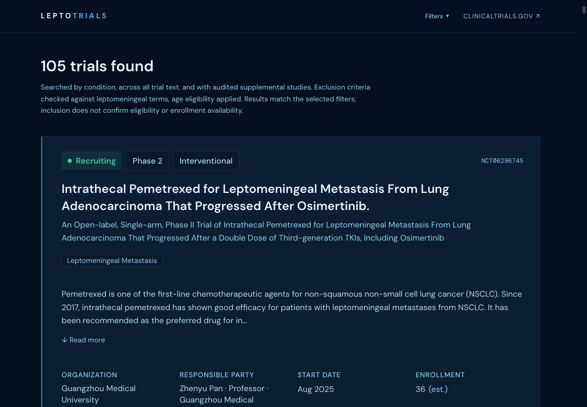

# LeptoTrials

A clinical trial finder for leptomeningeal metastasis (LM). Live at
**[leptotrials.com](https://leptotrials.com)**.



Whether a trial accepts LM patients is usually buried in the eligibility criteria or
in one cohort of a bigger study, so searching ClinicalTrials.gov for "leptomeningeal"
returns a lot of noise. LeptoTrials pulls the relevant studies, screens their criteria
for LM exclusions and lets you filter by:

- age
- primary tumor type (lung, breast, melanoma, GBM, other solid tumors)
- country or continent
- study type, phase and recruitment status

Each result shows the summary, eligibility criteria, locations and contacts, and you
can draft an email to the study team or open the original ClinicalTrials.gov record.
No account needed.

A study showing up in the results doesn't mean someone qualifies or that it's
enrolling. Always confirm with the study team and your care team.

## Running it locally

You need Node 22 (see `.nvmrc`) and npm. There are no API keys. The app calls the
public ClinicalTrials.gov API straight from the browser.

```bash
git clone https://github.com/tejgluth/LeptoTrials.git
cd LeptoTrials
npm ci
npm run dev
```

Then open http://localhost:5173.

## How search works

1. Two queries go to the ClinicalTrials.gov v2 API. `query.cond` uses MeSH synonym
   expansion, so "leptomeningeal metastasis" also matches things like "meningeal
   carcinomatosis". `query.term` searches every field, which catches brain-metastasis
   trials that only mention LM in their eligibility criteria. A small list of
   reviewed trials that neither query finds is fetched by ID.
2. Results are deduplicated and every page is fetched, so the count is the real total.
3. `src/utils/trialFilter.ts` splits the criteria into inclusion and exclusion,
   drops trials that exclude LM or require its absence, applies the age limits and
   buckets trials by tumor type.
4. `src/utils/manualAuditOverrides.ts` holds hand-reviewed decisions for trials the
   keyword rules get wrong, like a cohort that allows LM when another one excludes it.
   Those overrides win over the heuristics.

The [agent harness](agent-harness/) is a separate Python tool that classifies
candidate trials with an LLM and exports reviewed decisions in the same format as the
override table. The website never calls a model.

## Project layout

```
src/            React app (search form, results, filters, API client)
functions/      Cloudflare Pages Functions for contact counts and the admin dashboard
migrations/     D1 schema
scripts/        validate-trials.ts, a live check of search results against the API
tests/          unit and regression tests (node:test)
agent-harness/  Python LLM classification harness, see its README
```

Stack: React 19, TypeScript, Vite, Tailwind CSS 4, GSAP. Hosted on Cloudflare Pages
with a D1 database.

## Tests

```bash
npm run check   # tests + eslint + typecheck + build
```

`tests/reviewedStudies.test.ts` runs the filter against 121 real registry records
whose expected result was checked by hand. If you change anything in the query or
filter logic, also run the live validation:

```bash
npm run validate:trials -- --json
```

It runs a matrix of filter combinations against the API (responses are cached in
`.cache/` for 6 hours) and checks a list of trials that must or must not appear.

CI runs `npm run check` on every push. Harness changes also run the Python checks.

## Cloudflare backend (optional)

You only need this for the contact counts and the `/analytics` dashboard. Search
works without it.

```bash
cp .dev.vars.example .dev.vars   # set your own ANALYTICS_ADMIN_TOKEN
npm run d1:migrate:local
npm run dev:cloudflare
```

This serves the built site with the functions at http://localhost:8788. If you
deploy your own copy, point the D1 binding in `wrangler.jsonc` at your own
database and set the token as a Cloudflare secret.

## Privacy

There are no cookies, no local storage and no visitor IDs. When someone clicks or
copies a trial contact email, a counter for that NCT ID is incremented. That's all
the database stores. Global Privacy Control and Do Not Track turn off even that.
Fonts are self-hosted. The full disclosure is at `/privacy`.

The old trial suggestion form has been removed. `/api/trial-suggestions` returns 410.

## Disclaimer

LeptoTrials is for finding studies to discuss with a doctor. It isn't medical advice
and it doesn't decide eligibility. Trial data comes from
[ClinicalTrials.gov](https://clinicaltrials.gov). This project isn't affiliated with it.

AI coding tools were used during development.

## License

[MIT](LICENSE). The bundled fonts are under the SIL Open Font License (see
`public/fonts/`).
