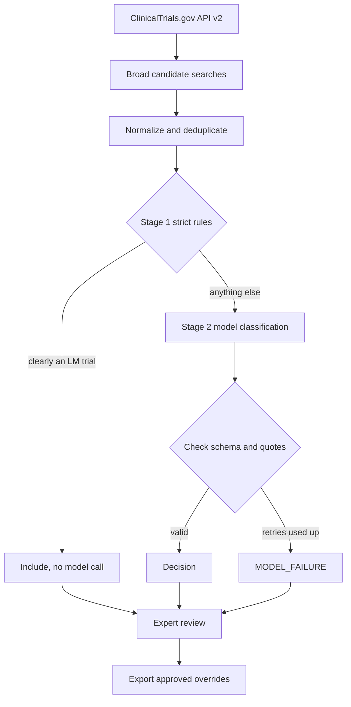

# LeptoTrials agent harness

A Python tool that decides whether a ClinicalTrials.gov trial lets patients with
leptomeningeal metastasis (LM) enroll. It's meant for the cases the website's
keyword filter can't handle, like an LM cohort inside a bigger trial, LM allowed only
if stable, or LM mentioned only as a washout condition.

It runs separately from the website. Its output is a list of proposed decisions that
someone reviews by hand before anything goes into the site's override table
(`src/utils/manualAuditOverrides.ts`).

## How it works



**Candidate search.** `config/default.yaml` lists about ten searches (LM, meningeal
metastasis, carcinomatous/lymphomatous meningitis, brain/CNS metastasis cohorts and
so on). These are wider than the website's queries on purpose. Every page is
fetched, and if any page fails the whole fetch fails, so a partial list never looks
complete.

**Stage 1** (`strict_classifier.py`) includes a trial without calling a model only
when the LM population is explicit and nothing contradicts it:

| Rule | Needs |
| --- | --- |
| `LM_CONDITION_EXACT_UNCONFLICTED` | an exact LM condition, either the only condition or backed up by the title |
| `LM_TITLE_POPULATION_UNCONFLICTED` | a title that says patients/participants **with** LM |

Any LM exclusion, cohort wording or conditional mention sends the trial to stage 2.
NCT06440954 and NCT07415018 are regression cases for this.

**Stage 2** sends the full normalized record to a model with prompt 1.7.0
(`prompts/`). The model has to choose one of these:

| Classification | Included |
| --- | --- |
| `LM_SPECIFIC` | yes |
| `LM_INCLUSIVE_GENERAL` | yes |
| `LM_INCLUSIVE_COHORT_SPECIFIC` | yes, has to name the cohort |
| `LM_EXCLUDED` | no |
| `LM_MENTION_ONLY` | no |
| `LM_NOT_INCLUDED` | no, the record doesn't establish a way for LM patients to enroll |

Every decision has to quote the source. `evidence.py` checks that each quote really
appears in the field it claims to come from (whitespace differences are allowed), that
the NCT ID and versions match, and that an exclusion isn't being used as inclusion
evidence. Invalid output is retried a few times with the errors fed back. If it still
fails, the trial is stored as `MODEL_FAILURE`. Nothing is guessed.

For small local models, the model doesn't copy quotes at all. It picks passage IDs
(`S001`, `S002`, ...) from a list of exact source passages, and `local_contract.py`
looks up the text. `generation_constraints.py` also limits the output grammar so the
model can't produce combinations we know are wrong.

Every run saves the exact model inputs, raw responses, prompts and hashes under
`output/runs/<run_id>/`. Results are cached by content hash, model and prompt
version, so unchanged trials aren't classified again.

## Setup

Python 3.11+.

```bash
cd agent-harness
python3 -m venv .venv
source .venv/bin/activate
pip install -c requirements.lock -e '.[dev]'
cp .env.example .env   # add whichever API key you're using
```

Providers:

| Provider | Config | Key |
| --- | --- | --- |
| Gemini (default) | `config/default.yaml` | `GEMINI_API_KEY` |
| OpenAI | `config/openai.yaml` | `OPENAI_API_KEY` |
| Anthropic | `config/anthropic.yaml` | `ANTHROPIC_API_KEY` |
| Ollama (local) | `config/ollama.yaml`, `config/ollama-fast.yaml` | none |
| OpenAI-compatible | copy `config/openai-compatible.example.yaml` | set in the config |

For Ollama, pull the model in the config first (`ollama pull <model>`) and keep the
Ollama app running. The harness never downloads a model and doesn't fall back to a
cloud provider.

## Usage

`--config` and `--output-root` go before the subcommand. `--dry-run` works on most
commands and does everything except the model calls.

```bash
# one trial
leptotrials-harness classify NCT06440954 --dry-run
leptotrials-harness --config config/ollama.yaml classify NCT06440954

# fetch candidates and classify them
leptotrials-harness fetch-candidates --status recruiting --output candidates.json
leptotrials-harness run-batch candidates.json --workers 4

# fetch + classify only new/changed trials + write a review packet
leptotrials-harness --config config/ollama.yaml --output-root output/maintenance maintain
```

`examples/classify_single_trial.py` walks through how one tricky record gets
normalized and routed, without calling a model.

### Reviewing and exporting

```bash
leptotrials-harness review output/runs/RUN --output review.md
leptotrials-harness adjudicate output/runs/RUN expert-decisions.json
leptotrials-harness export-approved --run output/runs/RUN \
  --adjudications expert-decisions.json --format typescript \
  --output output/approved-overrides.ts
```

The reviewer checks each trial against the registry and fills in a decision
(`examples/adjudication-template.json`, schema in `schemas/adjudication.schema.json`)
with the run ID and input/decision hashes from the review packet, so the decision is
tied to the exact version of the record they looked at. Only approved or corrected
decisions are exported. The export has the same `{ siteEligible, tumorLabels }` shape
as the website's override table, and it's merged into the site by hand.

### Failed and interrupted runs

```bash
leptotrials-harness execution-report output --output output/report.json
leptotrials-harness prepare-retry output/runs/RUN --output output/retry.json
leptotrials-harness run-batch output/retry.json
```

`prepare-retry --manifest <round>.json` also picks up inputs an interrupted round
never got to.

## Running it on a schedule

`maintain` can be run every 15 minutes or so. A new NCT ID or a change to a trial's
eligibility, title, cohorts, status or ages causes a reclassification. Everything
else comes from the cache. The first run classifies the whole baseline, so expect it
to be slow. Keep the same `--output-root` between runs so the cache is reused.

On macOS, save this as `~/Library/LaunchAgents/com.leptotrials.maintenance.plist`
with your own paths (launchd doesn't expand `~`), and create
`output/maintenance` first:

```xml
<?xml version="1.0" encoding="UTF-8"?>
<!DOCTYPE plist PUBLIC "-//Apple//DTD PLIST 1.0//EN" "http://www.apple.com/DTDs/PropertyList-1.0.dtd">
<plist version="1.0">
<dict>
  <key>Label</key><string>com.leptotrials.maintenance</string>
  <key>WorkingDirectory</key>
  <string>/ABSOLUTE/PATH/Leptomeningeal/agent-harness</string>
  <key>ProgramArguments</key>
  <array>
    <string>/ABSOLUTE/PATH/Leptomeningeal/agent-harness/.venv/bin/python</string>
    <string>-m</string><string>leptotrials_harness</string>
    <string>--config</string><string>config/ollama.yaml</string>
    <string>--output-root</string><string>output/maintenance</string>
    <string>maintain</string><string>--workers</string><string>1</string>
  </array>
  <key>StartInterval</key><integer>900</integer>
  <key>RunAtLoad</key><false/>
  <key>StandardOutPath</key>
  <string>/ABSOLUTE/PATH/Leptomeningeal/agent-harness/output/maintenance/scheduler.stdout.log</string>
  <key>StandardErrorPath</key>
  <string>/ABSOLUTE/PATH/Leptomeningeal/agent-harness/output/maintenance/scheduler.stderr.log</string>
</dict>
</plist>
```

```bash
launchctl bootstrap "gui/$(id -u)" ~/Library/LaunchAgents/com.leptotrials.maintenance.plist
launchctl kickstart "gui/$(id -u)/com.leptotrials.maintenance"   # run once now
launchctl bootout "gui/$(id -u)/com.leptotrials.maintenance"     # stop
```

On Linux, use cron with `flock` so two runs can't overlap:

```cron
*/15 * * * * cd /path/to/agent-harness && flock -n output/maintenance/poll.lock .venv/bin/python -m leptotrials_harness --config config/ollama.yaml --output-root output/maintenance maintain --workers 1 >> output/maintenance/cron.log 2>&1
```

For a one-off overnight run on a frozen set of inputs with a local model, use
`scripts/offline_verify.py schedule --hours 8`.

## Validation data

`validation/` contains ten frozen rounds of real registry records, one per year from
2017 to 2026 (`manifests/`, `rounds/`, and the shared inputs in
`records/registry-inputs.json.gz`). They came from the current API, keeping only
records that were posted and last updated before each cutoff. That means they're
subsets, not full historical snapshots. Records edited after a cutoff are missing.

```bash
leptotrials-harness validate validation/manifests/round_10.json
leptotrials-harness validate-all
leptotrials-harness compare-models --manifest validation/manifests/round_10.json \
  --configs config/ollama-fast.yaml config/ollama.yaml
```

There are no expert labels for these rounds yet, so `validate` reports completion,
failures, latency and tokens, but not accuracy. Accuracy only gets computed once
adjudications are attached to a manifest.

For full historical snapshots there's an AACT pipeline (`aact.py`,
`scripts/prepare_aact_history.py`, `scripts/build_aact_evaluation.py`).
`validation/sources/aact-reconciled-v1.json` lists the ten dated
[AACT flat-file archives](https://aact.ctti-clinicaltrials.org/snapshots) used,
2017-10-17 to 2026-10-01. The 2020 round uses the September archive because the
October one had posted dates after its own snapshot date. The archives are a few GB
each, so they aren't in the repo.

`validation/sources/production-20261018.json` is the list of trial IDs leptotrials.com
showed with default filters on Oct 18. Use `reconcile-production` to compare it with
a run.

## Layout

```
src/leptotrials_harness/
  candidate_search.py, clinicaltrials_api.py   fetching
  trial_normalizer.py, terminology.py          normalizing + LM term signals
  strict_classifier.py                         stage 1
  agent_classifier.py, decision_pipeline.py    stage 2 + run orchestration
  *_client.py                                  model providers
  evidence.py, source_passages.py              quote checking
  local_contract.py, generation_constraints.py local model output format
  audit.py, export.py                          review packets, adjudication, export
  validation.py, metrics.py, historical.py, aact.py
config/       provider configs, search terms, thresholds
prompts/      system and task prompts (prompt_versions.json says which is current)
schemas/      JSON schemas generated from models.py
scripts/      maintenance, AACT import, offline verification
```

## Tests

```bash
pytest -q
ruff check src tests scripts examples
ruff format --check src tests scripts examples
leptotrials-harness schemas --check
```

None of these need an API key. CI runs them on any change under `agent-harness/`.
