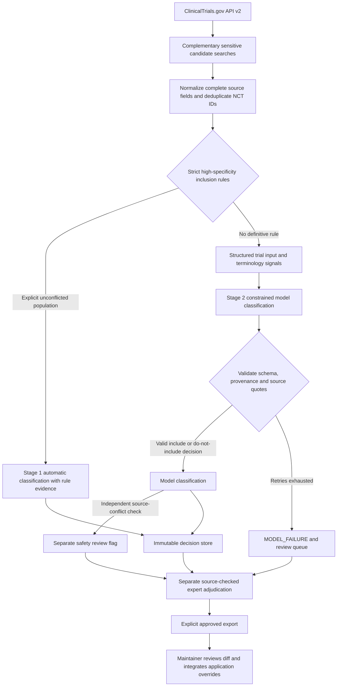
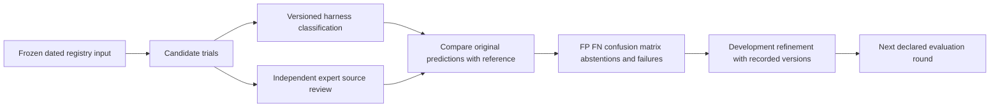
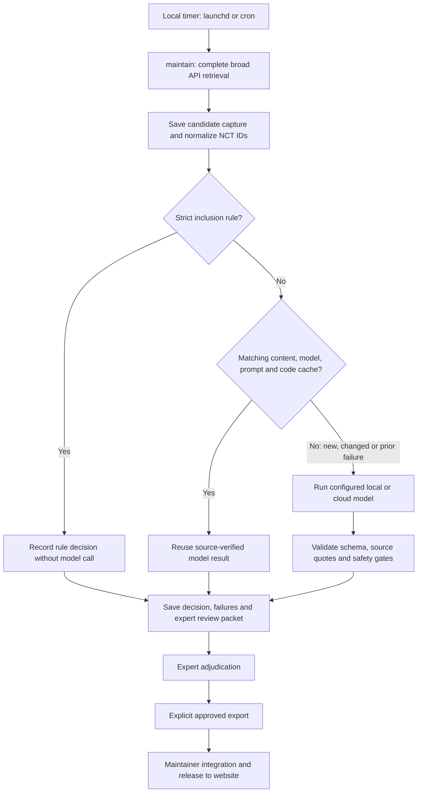

# LeptoTrials agent harness

The LeptoTrials agent harness is a separate background classification subsystem for
ClinicalTrials.gov records whose leptomeningeal metastasis (LM) enrollment permission
needs contextual review. Its prompts, exact inputs, evidence, decisions, validation
framework and expert audit can be inspected and run independently of the patient app.

**Implementation status:** runnable local research/maintenance subsystem. The patient
runtime still uses its existing search/filter/override code. This folder does not
change production membership or deploy anything. Gemini is the intended model;
OpenAI, Anthropic, local Ollama and explicit OpenAI-compatible endpoints are configurable adapters.
Provider/model changes create distinct runs and invalidate model caches.

## Architecture

ClinicalTrials.gov does not encode metastatic-site enrollment permission consistently.
LM can appear only in eligibility or a particular cohort, while another cohort excludes
it. Title/condition searches alone miss these cases. Conversely, LM background,
outcomes or washout language alone does not establish permission.



This is structured ingestion, deterministic routing, constrained model classification,
evidence verification, expert adjudication and versioned export. It is not generic
retrieval-augmented chat or autonomous medical decision-making. No extra agents,
browsing tools or hidden tool loops are involved. The pipeline, not the model, controls
retrieval, retries, acceptance, audit and export.

### Stage 1: conservative inclusion

`strict_classifier.py` implements two versioned rules informed by
[`trialFilter.ts`](../src/utils/trialFilter.ts):

| Rule | Required evidence |
| --- | --- |
| `LM_CONDITION_EXACT_UNCONFLICTED` | An exact malignant LM condition, as the sole condition or supported by an explicit LM population title |
| `LM_TITLE_POPULATION_UNCONFLICTED` | Title explicitly says patients/participants/subjects **with** LM |

Both defer if any detected LM exclusion, negative or qualifying passage appears.
Broad condition substrings, acronym-only conditions, generic title mentions,
washout language and mixed cohorts cannot independently bypass Stage 2.
Signals are recomputed even for imported normalized records.
Rule version `strict-1.1.0` additionally defers explicit cohort/part wording and
mixed brain-or-LM populations. An LM condition alone must not label a broader CNS
study `LM_SPECIFIC` (which requires an entirely LM-defined enrollment population).

These are **new conservative implementation rules**, not a claim to have recovered
the paper's exact historical rules. The app's wider parser and overrides are not
copied as historical truth: they lack matching immutable input fingerprints and
some audit artifacts are explicitly blocked/unreleased. NCT06440954 is a regression
case: positive title/inclusion plus a meningeal exclusion must reach contextual review.

### Stage 2: broad discovery and constrained contextual review

`config/default.yaml` contains complementary LM, meningeal, hematologic meningitis,
brain/CNS metastasis and disease-specific/cohort queries. Every page is followed;
any failed page, repeated token, malformed record or page-limit overflow fails
retrieval. No partial candidate set is passed off as complete. All statuses can be
included; default maintenance statuses match the app's three default statuses.
Searches are intentionally broader than the current app; they do not define live
website membership. Candidate retrieval recall and classifier performance are separate.

`trial_normalizer.py` preserves titles, conditions, keywords, summaries, detailed
description, full eligibility plus section views, ages/sex, named arms/cohorts,
interventions, outcomes, public location fields, sponsor and registry dates.
Nothing summarizes away negation, conditions or cohort boundaries. Public contact
names/emails and patient data are not needed by the model input.

Input schema `1.1.0` also preserves the registry's study population separately as
`eligibility.population`. Legacy `1.0.0` inputs retain their original submitted
payloads and fingerprints; adding an empty population field does not invalidate
historical evidence. Current output schema `1.1.0` requires a boolean decision; immutable `1.0.0` outputs remain readable under their original contract.

The exact submitted JSON is saved in each run's `model_inputs/`. System/task text is
saved in the manifest. The model answers only: **does the registry establish an LM
enrollment path, and at what scope?** It must distinguish explicit permission,
conditional stable/asymptomatic permission, symptomatic exclusion, separate cohorts,
unqualified conflicts, background/outcomes and prior-treatment/washout mentions.

| Classification | Binary LM inclusion |
| --- | --- |
| `LM_SPECIFIC` | true |
| `LM_INCLUSIVE_GENERAL` | true |
| `LM_INCLUSIVE_COHORT_SPECIFIC` | true, with named cohort evidence |
| `LM_EXCLUDED` | false |
| `LM_MENTION_ONLY` | false |
| `LM_NOT_INCLUDED` | false; registry text does not establish an applicable LM enrollment pathway |

Prompt `1.7.0` makes a concrete registry-list inclusion decision for every successful response. Unclear/ambiguous/insufficient-information classifications, null decisions and model-requested human classification are rejected in current outputs. The same restriction is enforced by each provider's generation schema, the canonical JSON Schema and the runtime validator. When the registry does not establish LM permission, the model returns `LM_NOT_INCLUDED` and false with its rationale and confidence. This means do not include the record in this list; it does not assert that all LM patients are clinically excluded. Missing context is never silently promoted to permission. Actual model/validation failures still remain failures rather than fabricated decisions.

The old unresolved categories remain supported only when reading historical output schema `1.0.0` artifacts. Retained historical outputs keep their original schema and provenance. The prompt/schema/implementation changes invalidate old classification cache keys. New live requests reject legacy-schema responses even though archive readers can still inspect them.

Affirmative and explicit-exclusion decisions require directional evidence. A do-not-include decision may use context/exclusion passages, or no evidence if no relevant source information exists; it must explain the limitation. Quotes must resolve to
their declared field and match the source, allowing whitespace normalization only.
Invented quotes, wrong NCT IDs, inconsistent labels, unsupported enums, missing
fields and wrong prompt/schema provenance are rejected. Malformed outputs get
bounded retries and retain rejection diagnostics. Exhaustion stores `MODEL_FAILURE`,
never a guessed negative. Unscoped conflicts also trigger a separate safety review
flag without rewriting the raw model decision. Confidence is descriptive, not
calibrated, and is never an acceptance threshold.

Cohort-specific proposals additionally need a source-defined cohort identifier
linked to affirmative quoted evidence or that cohort's own arm field. Another
cohort's exclusion cannot serve as its inclusion evidence. A plain exclusion-section
passage cannot be relabeled inclusion without an explicit permission/exception.
Generic brain/CNS-only wording cannot establish explicit `LM_EXCLUDED`.
Placeholders such as `N/A`, or a cohort name found only in derived signals rather
than clinical source text, trigger expert review instead of automatic acceptance.

### Verbatim copying aids and development rejection analysis

Prompt `1.7.0` retains the source-reference mechanism from `1.6.0`, including complete normalized trials and `source_passages`:
short contiguous source excerpts with real field paths and, where headings are
available, a deterministic section hint. They preserve punctuation, source typos,
literal AACT `~` delimiters, negation and nearby cohort language. These are copying
aids, **not pre-classifications**, exhaustive excerpts or summaries. The full
record remains necessary to interpret them.

Local Ollama uses the explicit, separately typed
[`ollama_reference_output.schema.json`](schemas/ollama_reference_output.schema.json)
transport. Each model evidence object selects a `source_passage_id` (for example,
`S003`), direction, cohort and interpretation. After validating that wire JSON,
`local_contract.py` resolves **both** its exact field and quote from the submitted
source catalog. The canonical classification is then validated normally. This is
a declared source-reference lookup, not fuzzy repair of malformed quotes. Raw wire
JSON remains saved in attempts; canonical `result` retains the ordinary full evidence
format used by every provider. Unknown references, extra/free-quote keys and malformed
wire output are rejected, not guessed or coerced.

Local directional branches omit plain exclusion anchors from inclusion choices,
while retaining explicit LM exceptions. This does not infer eligibility from headings.
The harness independently checks the resolved field/quote pair and rejects wrong
attribution, unsupported direction, cohort scope and inconsistent taxonomy. Other
providers retain exact-quote verification but are not forced to the local copying
transport. When necessary context is unavailable, the model chooses `LM_NOT_INCLUDED` and explains the limitation; the catalog must never manufacture permission. A retry may receive nearby real source excerpts,
but no fuzzy match is accepted and no rejected model output is silently repaired.
Raw attempts, failures and earlier prompt versions remain separate and immutable.
Conditional LM permission is not itself a named enrollment cohort; unsupported
cohort naming is rejected during model attempts so it can be corrected or replaced with a supported do-not-include decision,
not silently accepted as a valid cohort-specific result.

The local wire taxonomy omits the cohort-specific option when neither cohort/part
text nor multi-arm structure supplies a cohort signal. General permission, explicit exclusion, mention-only and `LM_NOT_INCLUDED` remain available. If an unidentifiable population restriction prevents establishing permission, choose `LM_NOT_INCLUDED` rather than unrestricted inclusion. Qualified symptomatic/active-only LM
exclusion also cannot automatically become exclusion of **all** LM; missing conflicting
source evidence triggers a new bounded attempt or review.

### Generation constraints and local recovery

The local generation schema now binds each classification to its boolean decision and required evidence. Affirmative evidence must reference an LM-bearing source passage; cohort-specific references are limited to real source names linked to the selected passage or its own arm. Unsupported generic CNS exclusions and qualified active/symptomatic-only restrictions cannot be generated as blanket `LM_EXCLUDED` decisions. An affirmative result must retain relevant exclusion evidence when the source contains a conflict. The model still interprets the complete record, and the independent source/semantic verifier runs after generation.

Native Ollama requests keep the installed model resident for 30 minutes, use bounded connection retries and allow three model attempts in `config/ollama.yaml`. Temporary transport/server failures can retry; deterministic HTTP 400 errors stop that record without poisoning the rest of the batch. Authentication/model-not-found errors stop the provider instead of generating repeated failures. No model is downloaded and no cloud fallback is introduced. Server response bodies are not copied into error logs.

Per-record `failure_kind` and execution-report counts distinguish `MODEL_OUTPUT_REJECTED` from `INFERENCE_ERROR`, while retaining the existing machine-readable `MODEL_FAILURE` field for compatibility. Older runs can be inspected under this breakdown without changing their raw records. New regression tests cover the overnight error patterns, malformed output dependencies, source/cohort binding, temporary recovery and record-scoped versus provider-wide stops.

### Historical eligibility-section projection

The historical development inputs exposed a normalization bug: AACT's literal `~`
line separators and inline headings were not recognized by the original line-start
parser, so the entire eligibility—including exclusions—appeared in `inclusion_text`.
`eligibility_sections()` now recognizes those explicit headings without rewriting
the raw text. Unsectioned criteria remain raw, not an invented inclusion section.

Existing frozen inputs and source hashes are **not rewritten**. A deep-copy model
projection `eligibility-headings-1.0.0` rebuilds the derived inclusion/exclusion views
and terminology signals from their original raw eligibility. The submitted payload
records projection version and original input hash. The exact model input is saved
with its own hash. Criteria evidence is bound to `eligibility.raw_text`, not the
reconstructed section fields, so every resolved quote still checks against the
unchanged archived source. This is input organization for development, not a new
registry snapshot or expert correction.

Terminology version 1.2 recognizes oncology plurals and malignancy wording as well
as explicit expanded LM context when resolving abbreviations. Current NCT07415018
is a regression: its LMD exclusion must prevent a strict-condition bypass even
though the condition says Leptomeningeal Disease. The record goes to contextual
review; its NCT number is not hard-coded into classification rules.

The October 18 historical 50-record development run exposed both quote-formatting
failures and semantic mistakes despite schema-valid outputs. Repeatedly correcting
these examples is prompt development, not independent expert validation. See
[`validation/`](validation/) for the source snapshots and execution reports.

### Compare against the live production website

Capture exact displayed IDs and filters from `https://leptotrials.com` first. Never
derive that baseline from local overrides, a preview or an unreleased audit. The
October 18 default search capture is
[`production-20261018.json`](validation/sources/production-20261018.json): 105 IDs,
including NCT06440954. The accompanying current broad API capture retrieved 635
candidates and contained every one of those 105 live IDs. This checks retrieval
coverage of the live baseline, **not classifier accuracy** or complete recall.

After a batch, compare membership without changing either side:

```bash
leptotrials-harness reconcile-production \
  --baseline validation/sources/production-20261018.json \
  --candidates output/current-reconciliation-20261018/candidates.json \
  --run output/RUN_ROOT/runs/RUN_ID \
  --output output/new-production-comparison.json
```

The report separates proposed inclusions, safely accepted inclusions, review cases,
failures, unprocessed records, live-only and harness-only IDs. It checks filters and
source/decision fingerprints. Incomplete processing cannot pass parity. The current
command supports the unrestricted default filters; patient-age/tumor/location
comparisons require a corresponding captured baseline and filtering implementation.

Production membership is an authoritative **compatibility/export baseline**, not an
independent clinical reference. For example, NCT06440954 is displayed live but its
source contains conflicting mandatory LM inclusion and meningeal exclusion. Preserve
its live membership while raising research review; do not remove it from a website
export, silently force an unambiguous classifier answer, or change production.

## Local setup

Python 3.11+; no frontend server or database required.

```bash
cd agent-harness
python3 -m venv .venv
source .venv/bin/activate
pip install -c requirements.lock -e '.[dev]'
cp .env.example .env  # only if you do not already have a local .env
```

Set credentials locally; do not paste keys into review files or commit `.env`.
The CLI loads only `agent-harness/.env` when invoked from that directory, plus
existing environment variables. No credentials are saved in run manifests.

```bash
# Inspect a real difficult record, no API key or model call required
leptotrials-harness classify NCT06440954 --dry-run

# Intended Gemini configuration: gemini-3.8-flash, high thinking
leptotrials-harness classify NCT06440954

# Temporary OpenAI testing: requires OPENAI_API_KEY in .env
leptotrials-harness --config config/openai.yaml classify NCT06440954

# Broad candidate capture, then batch classification
leptotrials-harness fetch-candidates --status recruiting --output candidates.json
leptotrials-harness --config config/openai.yaml run-batch candidates.json

# Complete maintenance run: discover, classify/reuse cache, produce expert review packet
leptotrials-harness --config config/openai.yaml maintain

# Frozen historical round, all rounds, and matched-input model comparison
leptotrials-harness --config config/openai.yaml validate validation/manifests/round_10.json
leptotrials-harness --config config/openai.yaml validate-all
leptotrials-harness compare-models --manifest validation/manifests/round_10.json \
  --models google:gemini-3.8-flash openai:gpt-6-sol

# Compare full settings (e.g. local thinking off/on); use a small development manifest first
leptotrials-harness compare-models --manifest PATH_TO_FROZEN_MANIFEST.json \
  --configs config/ollama-fast.yaml config/ollama.yaml --workers 1
```

`--dry-run` also works for batch, maintenance, validation and comparison. It applies
Stage 1, saves exact Stage 2 inputs and makes **zero model calls**, even if cache is
available. `--no-cache` forces fresh batch classifications. Global options such as
`--config` and `--output-root` go before the subcommand. Files are create-only;
choose a new output path rather than silently replacing evidence.

Batch and validation commands accept `--workers 1` through `--workers 32` for bounded
concurrency; the default is one. Request completion order does not change manifest
input ordering. Start with a single-trial check before a paid batch. Rate-limit
failures stay explicit; a later rerun can reuse successful cached classifications.

### Provider options

| Provider | Adapter | Credential / config |
| --- | --- | --- |
| Google Gemini | Official `google-genai` Interactions API; JSON schema; high thinking | `GEMINI_API_KEY`; default YAML |
| OpenAI | Official SDK Responses API; strict JSON schema; configured reasoning | `OPENAI_API_KEY`; `config/openai.yaml` |
| Anthropic | Messages API; structured output; adaptive thinking | `ANTHROPIC_API_KEY`; `config/anthropic.yaml` |
| Ollama local models | Native local chat endpoint, same schema/pipeline, explicit context limits | no API key; `config/ollama.yaml` |
| Other compatible services / local models | OpenAI-compatible Chat Completions with strict JSON schema | explicit `base_url`, model, key environment variable; example YAML |

Model IDs and settings live in config, never scattered through classification logic.
`compare-models --configs` preserves each variant's endpoint, reasoning/thinking,
context and pricing rather than applying one provider's settings to another. It
forces Stage 2 on identical inputs with cache disabled; without expert references,
the comparison measures execution/schema failures/latency, not clinical accuracy.
Use `--config config/ollama.yaml` to run the same harness with locally installed Gemma
or another Ollama model. See [local model instructions](docs/ollama.md). No paid model
API is called in this mode; results and caches retain their local model identity/digest.
Supply `HARNESS_PROVIDER` **and** `HARNESS_MODEL` for an environment override. Compatible
endpoints must support the requested JSON-schema interface; unsupported capabilities
produce explicit failures. There is no automatic downgrade to free text or another
provider. Anthropic's wire schema omits unsupported grammar bounds; the complete
local Pydantic schema still enforces those bounds. OpenAI reasoning models omit
temperature by default; enable it only for a model that supports it.

Provider APIs: [Gemini structured output](https://ai.google.dev/gemini-api/docs/structured-output),
[Gemini thinking](https://ai.google.dev/gemini-api/docs/thinking),
[OpenAI structured output](https://developers.openai.com/api/docs/guides/structured-outputs),
[Anthropic structured output](https://platform.claude.com/docs/en/build-with-claude/structured-outputs).
Live service tests and research validation are different from mocked adapter tests;
see the checked-in validation report for what actually ran.

## Expert review and application integration

```bash
# RUN is the run_id printed by a completed command
leptotrials-harness review output/runs/RUN --output review.md
leptotrials-harness create-audit-batch --since 2026-10-01 --output audit_batch.csv
leptotrials-harness adjudicate output/runs/RUN expert-decisions.json
leptotrials-harness export-approved --run output/runs/RUN \
  --adjudications expert-decisions.json --format json \
  --output output/approved-classifications.json
leptotrials-harness export-approved --run output/runs/RUN \
  --adjudications expert-decisions.json --format typescript \
  --output ../src/generated/agentClassifications.ts
```

An expert uses the linked underlying registry source, records a pseudonymous reviewer
ID, date, taxonomy, `source_checked=true`, explicit tumor labels, and approve/change/reject
disposition. Use [`adjudication.schema.json`](schemas/adjudication.schema.json).
Copy `run_id`, `input_hash` and `decision_hash` from the review packet to bind the
decision to the precise revision. Expert records are separate and immutable. A
correction stores original model decision, expert decision and final decision.
Rejected, unresolved, unchecked or revision-mismatched decisions cannot become exports.
Even a Stage 1 auto-accept requires this explicit review before application export.
Review packets expose the safety gate/status, run ID, input/decision hashes and failure
diagnostics. A fully processed batch with model failures can still export separately
expert-corrected records; use `disposition=change`, not `approve`, when no valid model
decision exists. Dry runs and interrupted/incompletely processed runs cannot export.

The TypeScript artifact is typed as the app's existing `ManualAuditOverride` and
exports `{siteEligible, tumorLabels}`. Tumor labels come from expert review; general
LM inclusion never invents histology-specific eligibility. Empty labels intentionally
mean general-only. A provenance sidecar accompanies TypeScript. The exporter refuses
to overwrite existing files and does not change `manualAuditOverrides.ts`, import
the generated module, commit, merge or deploy. A maintainer must review/merge the
candidate into the audited override workflow, run the app's regression checks and
follow its normal release process. Schema compatibility does not imply release approval.
When exporting outside the checkout or from an installed wheel, pass `--app-root /path/to/Leptomeningeal`
to locate the actual application type. Both TypeScript and provenance destinations
must be unused; an existing sidecar cannot be silently replaced.

**Production exports remain governed by the live website.** This harness's candidate
sets, historical subsets and generated classifications are not production trial
membership. A spreadsheet described as current LeptoTrials must capture the exact live
IDs at `https://leptotrials.com`, preserve order and reconcile count/uniqueness/set equality,
including NCT06440954 whenever live. Blocked audit folders never supersede production.

## Validation and scientific limits



### Historical data sources and provenance

The historical source data come from **[AACT's dated ClinicalTrials.gov flat-file
archives](https://aact.ctti-clinicaltrials.org/snapshots)**, acquired on October 18,
2026. AACT is the archive provider; ClinicalTrials.gov is the underlying registry.
These are archived relational tables, **not historical responses reconstructed by
querying today's ClinicalTrials.gov API v2**. The accepted collection is
`aact-reconciled-20261018-v1`; each source below links to its actual AACT download
record (AACT sign-in may be required).

| Round | Accepted archive date | AACT source | Broad candidates |
| --- | --- | --- | ---: |
| 01 | 2017-10-17 | [Archive 376](https://aact.ctti-clinicaltrials.org/snapshots/flat/376/download) | 17,926 |
| 02 | 2018-10-01 | [Archive 394](https://aact.ctti-clinicaltrials.org/snapshots/flat/394/download) | 19,663 |
| 03 | 2019-10-01 | [Archive 416](https://aact.ctti-clinicaltrials.org/snapshots/flat/416/download) | 21,536 |
| 04 | 2020-09-01 | [Archive 402](https://aact.ctti-clinicaltrials.org/snapshots/flat/402/download) | 23,368 |
| 05 | 2021-10-04 | [Archive 366](https://aact.ctti-clinicaltrials.org/snapshots/flat/366/download) | 25,788 |
| 06 | 2022-10-01 | [Archive 1405](https://aact.ctti-clinicaltrials.org/snapshots/flat/1405/download) | 28,673 |
| 07 | 2023-10-01 | [Archive 2300](https://aact.ctti-clinicaltrials.org/snapshots/flat/2300/download) | 30,895 |
| 08 | 2024-10-01 | [Archive 3021](https://aact.ctti-clinicaltrials.org/snapshots/flat/3021/download) | 33,288 |
| 09 | 2025-10-01 | [Archive 3701](https://aact.ctti-clinicaltrials.org/snapshots/flat/3701/download) | 35,779 |
| 10 | 2026-10-01 | [Archive 4419](https://aact.ctti-clinicaltrials.org/snapshots/flat/4419/download) | 38,647 |

The total is **275,563 broad candidate record-round pairs**, not unique trials,
LM-inclusive trials, completed model classifications or expert-verified decisions.
Candidate selection scans each dated study universe using versioned sensitive text
rules; it does not recreate the registry's historical search index. No current
eligibility text is substituted for archived text.

**Source exception:** the nominal [2020-10-01 archive
371](https://aact.ctti-clinicaltrials.org/snapshots/flat/371/download) was rejected
because 1,130 posted-date values exceeded its listed date. Round 04 explicitly uses
the September archive instead; the October archive was not silently relabeled.

To trace or reproduce the data preparation, consult:

- The [accepted-source recipe](validation/sources/aact-reconciled-v1.json), which
  binds each round to its retained import and records the 2020 replacement.
- The [source and fingerprint report](validation/reports/2026-10-18-aact-reconciled-source-plan.json),
  which records source URLs, dates, table checksums, input fingerprints and selected
  development records; the [reconciliation report](validation/reports/2026-10-18-aact-reconciliation.md)
  explains the counts and exclusions.
- The [acquisition, integrity checks and import instructions](docs/historical-aact.md),
  including protocol-table CRC/SHA-256 verification and the distinction between
  table verification and a whole-archive checksum. Original joined source rows and
  normalized inputs are retained locally under
  `output/aact-reconciled-20261018-v1/full/`; large archives and generated execution
  outputs are not bundled with the public code.

**Source availability is not validation completion.** The bounded historical model
development set contains five sampled records per round: **50 source revisions
across 47 distinct NCT IDs**, not all 275,563 candidates. Selection uses observable
text strata and seed `aact-dev-smoke-2026-10-18-v1`, not expert labels or a
proportional population sample. It is development testing, not a held-out accuracy
estimate. Actual model completion and failures are recorded separately in run
artifacts. Independent expert adjudications have not been supplied for this new
collection, so clinical FP/FN and accuracy are not established. These newly assembled
rounds must not be presented as the original manuscript's experiments.

### Earlier API-derived retrospective subsets

The separate [`validation/README.md`](validation/README.md) also documents an earlier
track built from current API v2 records using annual cutoffs in 2017–2026. Only
records first posted and last updated by each cutoff were retained. Those are
unchanged-record survivor subsets, **not complete historical populations**: records
modified after a cutoff are absent even if they existed then. The internal registry
history endpoint returned 403 during that work. Do not combine this track's counts
with the AACT collection or describe its inputs as archived historical API responses.

Actual archived snapshots can be imported without refetching today's text:

```bash
leptotrials-harness import-snapshot archived-records.json --date 2017-10-17 \
  --round round_01 --destination output/archive-validation \
  --provenance 'Archive source, capture method, version and checksum' --role unspecified

# Genuine relational AACT flat-file archive, not an API-v2 JSON capture
leptotrials-harness import-aact /path/to/dated-flat-files.zip --date 2017-10-17 \
  --round round_01 --destination output/aact-historical \
  --provenance 'AACT archive page/download URL, source date and capture method'
```

The AACT importer scans the entire dated study universe, joins twelve required
protocol tables, preserves source rows, and records table checksums and counts.
Missing tables, orphan relationships, duplicate records, or available source dates
after the declared snapshot fail the import. These archives are an additional,
genuine historical input track, separate from the unchanged-current-record subsets.
See [archive acquisition and execution](docs/historical-aact.md) for the actual
annual source plan, optional selective downloads, and offline routing checks.

Reference classifications must be independently source-checked expert adjudications.
Models, existing app overrides and these synthetic examples cannot manufacture expert
ground truth. Metrics stay null until adjudications are attached to the correct
input revision. A dry run is a routing/infrastructure test, not a model evaluation.
Development roles are explicit; no held-out split or historical prompt/model comparison
is invented. Prompt versions identify this implementation’s policies, not recovered
experimental prompts. Retain the exact prompts used by published result bundles.

The framework calculates TP/FP/TN/FN, PPV, NPV, sensitivity/recall, specificity,
accuracy, F1, multiclass confusion matrix, per-class accuracy, review rate,
schema/API failure rates and expert disagreements. Abstentions/failures remain in
overall accuracy and coverage denominators. Conditional resolved-only precision/
recall are labeled and must be read with coverage. Failed records are never true
negatives. Empty denominators are null. Aggregates count each record-round pair;
repeated trials and development/final roles must be considered when interpreting them.
Retrieval recall requires a separately supplied inclusive reference universe.

The methods description supplied with this project reports development over ten
temporal rounds with neuro-oncology review and no observed FP/FN in the final set.
The original expert adjudications and original experiments' frozen inputs are not
available in this checkout, so this implementation does not assert that result as independently
reproduced. When supported by actual adjudications, the appropriate wording is:
“No false-positive or false-negative LM classifications were observed in the final
expert-adjudicated validation set.” Never claim guaranteed future accuracy.

The supplied independent comparison (106/106 versus 84/106, 22 additional trials;
16 without LM in title/condition, 19 with permitting eligibility language, five with
dedicated LM cohorts) motivates protocol/cohort review. It is a separately reported
scientific comparison, not this harness's classifier metrics or a current live count.

Expert audit remains necessary for novel language, incomplete records, conflicting
criteria and cohort changes. The harness classifies **trial-level registry inclusion**,
not patient eligibility, treatment suitability, prognosis or enrollment availability.
It contacts nobody, changes no medical records, and provides no medical advice.

## Reproducibility, failure handling and cost

Runs store immutable normalized inputs, exact model payloads, raw final JSON responses
(including rejected attempts), verified evidence, minimal JSONL events and manifests.
No chain of thought is requested or saved. Manifests include provider/model, prompts
and hashes, schemas, rule version, implementation hash, git commit/dirty flag,
timestamps, input hashes, retrieval source, runtime, token usage and failure counters.
Raw response/model provenance remains separate from expert records. Public registry
inputs are suitable for source review; generated reports quote only necessary excerpts.

The cache key includes NCT/content, provider/model/config, exact prompts/schema,
terminology, rule version and Python implementation hash. Only successful source-verified
outputs are cached. Eligibility, title, cohorts, status, age and other substantive changes
invalidate reuse. Last-update timestamp and retrieval reasons alone do not. Cache hits
record their source run and do not count as fresh model calls. Concurrent scheduled
runs should be serialized by the scheduler; a shared artifact path is create-only.

Registry and model requests have explicit timeouts and bounded exponential retry.
Failed discovery exits nonzero and creates a failure artifact. Exhausted model
classification keeps a reviewable failure and the batch exits nonzero. There is no
silent skip, guessed result, unlimited loop or provider substitution. Unknown token
usage/prices remain unknown; set dated per-million prices to estimate cost. Actual
record/call latency is measured, with no claim of a sub-minute production SLA.

Non-retryable provider errors (including exhausted credits, invalid keys and unavailable
models) halt further model calls in that run and block subsequent validation rounds.
Retryable throttling honors a bounded Retry-After delay. A run can still retain valid
cached results. Raw errors are recorded as safe codes, without upstream response bodies.

## Scheduling

### Automatic discovery of new or changed trials

`maintain` is a **single polling cycle**: rerun all configured broad API searches,
follow every page, deduplicate by NCT ID, save a complete candidate capture, and run
the two-stage pipeline. An external timer repeats that command; the model does not
watch the registry or schedule itself. There is no push/webhook listener here.



Run from `agent-harness/`:

```bash
# Safe first inspection; fetches current registry data but makes zero model calls
.venv/bin/leptotrials-harness --config config/ollama.yaml \
  --output-root output/maintenance maintain --dry-run --workers 1

# One real poll; leave output/maintenance intact for the next poll's cache
.venv/bin/leptotrials-harness --config config/ollama.yaml \
  --output-root output/maintenance maintain --workers 1
```

A **new NCT ID** has no matching cached decision, so it reaches strict rules and,
if not definitive, the configured model. An existing trial with changed eligibility,
title, cohorts, status, ages or other substantive input also invalidates reuse.
Unchanged model results are reused; strict rules are rechecked cheaply on each poll.
Timestamp-only and retrieval-reason changes do not force model calls. Failed model
outputs are not cached, so later polls can retry them. Current successful outputs always have a boolean decision. Historical unresolved/review results remain auditable but cannot satisfy the new prompt/schema cache keys.

The first real poll may classify a large baseline, not just newly registered studies.
Dry runs do not seed model results. Changing provider/model, prompts, schema or harness
implementation can require reclassification even when registry text did not change.
Keep one persistent output root and serialize polls against it.

This is **near-real-time maintenance when the polling workload permits**, not an
instantaneous website update. Detection waits for registry availability and the next
successful poll; model backlog and expert/release steps add further delay. A record
that no configured search retrieves cannot be recovered by the classifier. A trial
missing from a later candidate capture is not automatically deleted from production,
and historical decisions/cache entries remain preserved. Source-checked review is
needed before withdrawing a previously approved classification.

See [recurring live-registry maintenance](docs/scheduling.md#recurring-live-registry-maintenance)
for exact local macOS/cron setup, provider selection, monitoring, and the final
approved-export commands. These examples do not install or enable a job by themselves.

### Inspect, retry and resume saved work

These commands require no registry/model calls:

```bash
# OUTPUT_DIR contains runs/; also works while a job is active
leptotrials-harness execution-report OUTPUT_DIR --output output/execution-inspection.json

# Preserve original decisions and prepare only failed inputs for a new run
leptotrials-harness prepare-retry OUTPUT_DIR/runs/RUN --output output/retry-inputs.json

# An interrupted round: also recover unprocessed inputs from its ORIGINAL frozen manifest
leptotrials-harness prepare-retry OUTPUT_DIR/runs/RUN \
  --manifest validation/manifests/round_02.json --output output/resume-inputs.json

# A bounded development check (explicitly NOT an independent final evaluation)
leptotrials-harness prepare-retry OUTPUT_DIR/runs/RUN \
  --limit 3 --output output/development-retry.json
leptotrials-harness --config config/ollama.yaml run-batch output/development-retry.json --workers 1
```

Inspection verifies decision/source fingerprints, schema and exact quotes, and reports
unsealed files, failures, review flags and cache hits without altering any record.
It does not claim a live process is running merely because its manifest is missing.
New batches write a source-bound plan before classification so pending work is visible.
The retry selector checks frozen-source identity, retains decision lineage and records
the total matching count plus any sample limit. `--include-review` also selects valid
ambiguous/safety-flagged decisions. A retry batch is not the full original evaluation
population; do not present its performance as an independent accuracy estimate.

Current classifications use prompt 1.7.0 and require a binary inclusion decision.
Retry feedback includes safe contract violations and evidence errors. The latest
[verification summary](validation/reports/2026-10-19-local-validation.md) records the
completed batch and the distinction between output validation and expert review.

### Optional execution schedule

The harness is the implementation; a scheduler only starts it. Run the same
`maintain` command manually, through cron/CI, or from a scheduled ChatGPT task.
See [`docs/scheduling.md`](docs/scheduling.md) for the exact prompt and operating
requirements. No schedule, paid continuous service or deployment is created by installation.

## Tests and file map

```bash
pytest -q
ruff check src tests scripts examples
ruff format --check src tests scripts examples
leptotrials-harness schemas --check
python -m build --wheel
```

CI runs offline checks without credentials. Tests cover the actual failure modes:
negation/conflicts, cohort scope, source quotes, model/schema errors, incomplete
pagination, cache change detection, metrics/abstentions and reviewed export revision binding.
See [`docs/methods-map.md`](docs/methods-map.md) for implementation locations and
[`examples/`](examples/) for a registry example, smoke inputs and an adjudication template.
